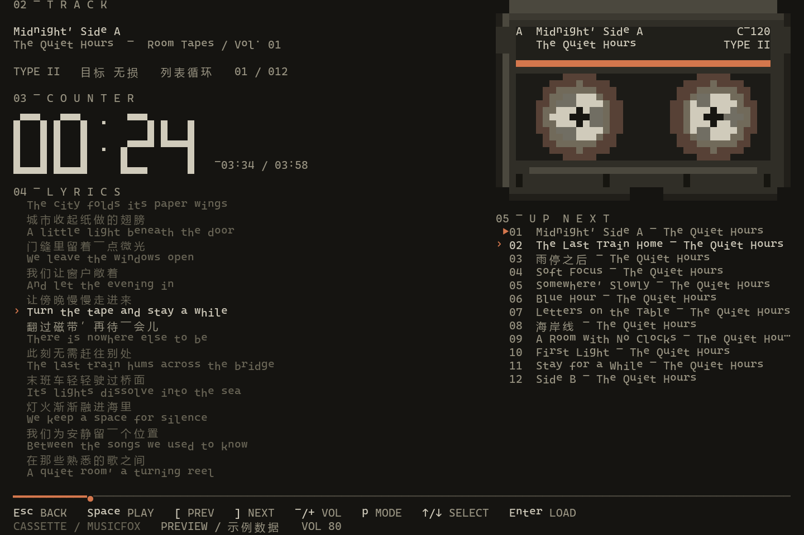
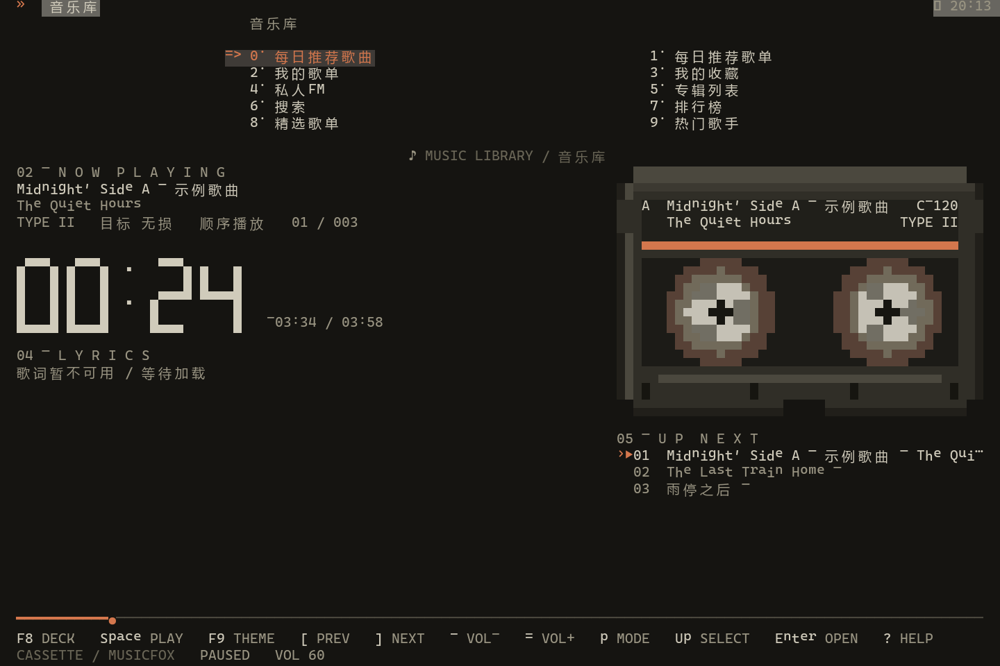
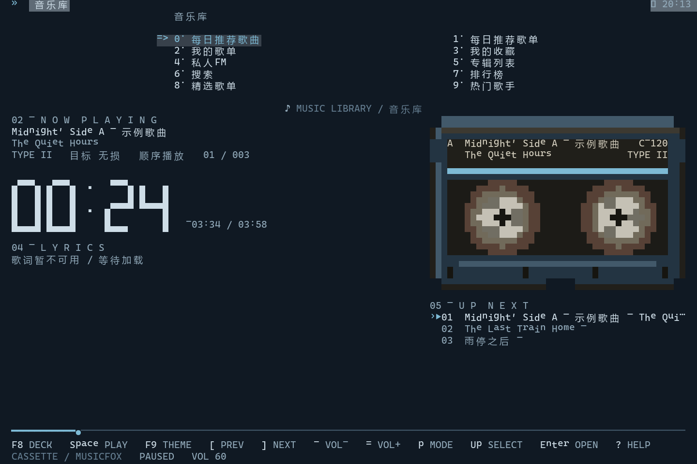
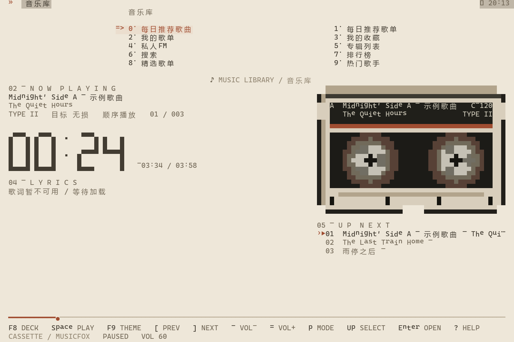

# 复古磁带视图

基于 go-musicfox 提交 `12169a71098f8b8607bcf655eaddabf57ca14daf`。本分支沿用原项目登录、网易云 API、播放引擎与歌词服务，将默认音乐库接入磁带面板，并提供独立全屏播放页，不需要终端图片协议。

## Windows 启动

可直接双击项目目录里的 **`Start-Musicfox.cmd`**，自动在 Windows Terminal 的像素字体配置中启动。该入口不依赖当前工作目录；启动命令出错会保留报错窗口。播放器异常退出时，专用终端配置也保留窗口，正常退出则关闭。

在项目目录的 Windows Terminal / PowerShell 中运行：

```powershell
.\Start-Musicfox.ps1
```

已构建的程序位于 `bin/musicfox.exe`。脚本默认使用项目下 `.local/user` 存放配置、登录状态、缓存和日志；若已经设置 `MUSICFOX_ROOT`，沿用该路径。直接运行可执行文件则遵循上游的默认配置目录规则。

1. 默认进入磁带主界面，在上方音乐库登录、选择歌单并播放。首次启动若出现更新日志弹窗，先按 Esc 关闭。
2. 按 **F8** 进入全屏磁带页面，按 **Esc / F8** 返回音乐库，播放继续。
3. 按 **F9** 切换主题，选择会自动保存；主界面和全屏播放页均可使用。

首次运行使用 `Cassette` 暖黑主题。旧配置保留原来的主题名，可修改如下设置后重启：

```toml
[theme]
layout = "cassette" # classic 可恢复原来的歌词/封面/频谱布局
activeTheme = "Cassette" # 或 Midnight Tape、Paper Tape
```

三种主题分别为暖黑橙色、午夜蓝和象牙纸色。目前它们共享磁带造型；收音机、MiniDisc、黑胶的独立造型尚未实现。主界面保持原菜单的 Enter、Space、翻页、搜索与鼠标语义，下面的按键表主要描述 F8 全屏播放页。

| 默认按键 | 操作 |
| --- | --- |
| Space | 播放 / 暂停；已恢复队列但未播放时启动当前曲目 |
| `[` / `]` | 上一首 / 下一首 |
| `-` / `=` | 降低 / 提高音量 |
| `x` / `X` | 快退 1 秒 / 5 秒 |
| `v` / `V` | 快进 5 秒 / 10 秒 |
| `p` | 切换播放模式 |
| F9 | 切换主题并保存 |
| F10 | 桌面歌词设置 |
| ↑ / ↓ 或 k / j | 移动队列选择；`›` 表示选择，`▶` 表示当前曲目 |
| Enter | 播放选中的队列曲目 |
| `?` | 查看原项目帮助 |
| q / Ctrl+C | 退出程序 |

播放控制沿用用户配置，底栏根据实际生效的绑定显示。可在配置中更改磁带入口：

```toml
[keybindings.app]
cassetteView = ["f8"]
switchTheme = ["f9"]
desktopLyricsSettings = ["f10"]
```

## 界面与缩放

### 像素字体

Windows Terminal 用户运行：

```powershell
.\Start-Musicfox.ps1 -Pixel
# 修改源码后重新构建并打开像素字体窗口：
.\Start-Musicfox.ps1 -Build -Pixel
```

脚本为当前用户安装仓库自带的 **Fusion Pixel 12px Mono zh-Hans** 字体，并创建独立的 `Musicfox Pixel` 终端配置；随后在新窗口启动播放器。中文、英文、菜单和歌词统一使用像素字体，缺失的符号由终端回退。字体许可证与来源见 [字体目录](../assets/fonts/fusion-pixel/README.md)。

字体使用 18pt（100% 显示缩放下为 24px，即原始点阵的两倍），禁用抗锯齿与强调文字加粗。其他 DPI 下可在该配置的“外观”中调整字号，使实际像素高度接近 12 的整数倍。建议窗口至少 120 列、40 行。

`Setup-PixelFont.ps1` 也可单独运行，不启动播放器。字体位于 `%LOCALAPPDATA%\Microsoft\Windows\Fonts`，配置片段位于 `%LOCALAPPDATA%\Microsoft\Windows Terminal\Fragments\Musicfox\pixel.json`，不更改其他终端配置。若已打开的 Windows Terminal 尚未识别新字体/配置，关闭该终端应用后重新运行。项目移动目录后重新运行脚本即可更新启动路径。

字体由终端渲染，普通 `Start-Musicfox.ps1` 沿用当前终端字体。macOS/Linux 或其他终端可安装同一 OTF 后手动设置字体家族。磁带布局的状态栏使用普通时间数字和空格分隔，不依赖 Nerd Font / Powerline 私用字形。

右键/操作菜单、帮助页、通知、歌词与队列指示符均使用内置字库支持的符号。其他内置主题和 classic 布局也默认使用空格分隔符，避免切换主题后出现 Powerline 缺字。开发时安装 Python `fonttools` 后运行 `python hack/check_pixel_glyphs.py`，可对照真实字体检查内置字符覆盖；歌曲标题和歌词等网络内容仍按原文显示。

### Windows 桌面悬浮歌词

`internal/desktop_lyrics/desktop_lyrics_windows.go` 提供原生置顶透明歌词窗口，不抢走终端焦点。显示当前句、下一句和翻译，复用播放器 LRC/YRC 行位置；暂停时保留（`hideOnPause=true` 可隐藏），停止播放或退出程序时隐藏/关闭，切换到没有歌词的歌曲时清空旧句。

在用户配置中启用后重启：

```toml
[main.lyric.desktopLyrics]
enable = true
fontName = "Fusion Pixel 12px Mono zh-Hans"
fontSize = 36
fontBold = false
fontItalic = false
vertical = false
textColor = "#E5C1B3"
shadowColor = "#101010"
xPositionFactor = 0.5
yPositionFactor = 0.15
draggable = true
hideOnPause = false
```

**右键桌面歌词**、在终端按 **F10**，或在终端右键菜单选择 **桌面歌词设置**，均可打开随主题配色的终端设置页。歌词锁定和未锁定时都保留右键入口；右键时尝试恢复并前置对应终端窗口，重复打开保留未完成的编辑。桌面上仅显示歌词，不再显示设置按钮或独立设置窗口。修改立即生效并自动保存，下次启动继续使用：

- 横排／竖排：竖排从上到下、各列从左到右显示，较长的句子自动分列；译文与下一句使用独立列，下一句颜色较暗。
- 字号：左右键减小／增大，范围 12–96px；像素字体以 12px 为步长，普通字体以 2px 为步长，Enter 可输入数值。
- 字体：左右键切换中文 Fusion Pixel、微软雅黑、宋体，Enter 可输入其他已安装的系统字体名称；支持加粗、斜体。
- 文字颜色与描边颜色：Enter 输入 `#RRGGBB`；不透明度范围 50–100%。
- 只显示当前句，或同时显示下一句；当前句的翻译仍保留。
- 锁定位置：禁止拖动，调整字号和歌词换行时保持窗口左上角位置；回到终端设置页即可解锁。
- 位置复位：移回屏幕底部中央。
- 上下键或 Tab 选择，左右键调整，Enter/鼠标点击编辑或切换；Esc 取消输入，再按 Esc 返回原页面。设置页随终端字体显示；像素启动器使用 Fusion Pixel。

未锁定时按住歌词区域即可拖动，窗口按内容收紧并保留点击留白。位置按主显示器比例保存，锁定后的左上角位置不随字号和显示方向变化。Fusion Pixel 随程序内置，无需另行安装，字号对齐到 12px 的整数倍以保持点阵清晰；其他系统字体不作此对齐。横排长行自动折行，竖排自动分列；竖排超出屏幕可用区域的尾部显示省略号。

Windows 当前按行同步，不含 macOS 的逐字渐变、频谱、圆角背景和模糊阴影；背景始终透明，阴影为清晰像素描边。其他 macOS 专用外观字段在 Windows 不生效。将 `enable=false` 后重启可关闭桌面歌词。

### 布局

- 默认暖黑底色、灰白文字和橙色强调；磁带使用半块字符和前后景色绘制，配色跟随当前主题。
- 左栏显示曲目、固定宽度数码时间和同步歌词；右栏显示磁带和队列。
- 宽度 80–109 列缩小磁带；小于 80 列或高度小于 22 行隐藏右栏。
- 主界面将菜单置顶，固定每页 10 项，预留音乐库提示/筛选输入区；剩余面板不足 19 行时隐藏磁带，优先保留曲目信息、歌词和底栏。主界面的鼠标进度条仍可定位播放，菜单点击与滚轮保持原行为。
- 主界面卷轴随播放进度与主刷新率更新，F8 页面使用独立 8 FPS 定时链；暂停时卷轴停止。
- 磁带布局下使用磁带面板替代原频谱、封面与歌词组件；`classic` 布局继续使用这些原组件。
- 长音频显示普通 `HH:MM:SS`，未知时长显示占位；底部操作区始终预留。
- 队列展示实际列表顺序。随机模式下它不是对未来随机结果的预测。
- “目标音质”是原项目的音质配置，不宣称实际解码的文件一定达到该质量。
- 当前行与译文复用歌词服务；纯音乐可显示服务原文，无内容时显示占位。

以下图片由实际 ANSI 渲染输出栅格化，使用示例歌曲与原创示例歌词，**不是登录后的终端截图**：



以下主界面图片来自原生菜单和磁带组件的实际渲染，采用离线示例歌曲，歌词未加载；同样不是在线账号播放截图：





## 重建和离线预览

本分支默认显示版本为 `v5.1.0+cassette`，检查更新时使用 `internal/types/constants.go` 中的 `UpstreamBaseVersion` 与上游发布版比较，不使用构建哈希或定制版本标记。当前源码已包含 v5.1.0；维护时合并包含新发布版的上游源码后，需要同步提升该基线。发现更高版本会提示查看上游发布说明；应将上游源码合并到定制分支并重建，直接替换为上游安装包不包含磁带改造。

```powershell
.\Start-Musicfox.ps1 -Build
```

需要 Go 1.26+ 与 C 编译器；本次环境已在 `.tools/go`、`.tools/mingw64` 准备工具链，并验证下载校验值。这些工具、构建产物和本地用户数据不纳入 Git。构建使用仓库 vendor 依赖和 `purego` 标签；未启用可选全局热键。

生成无音频、无需登录的静态 ANSI 预览：

```powershell
.\.tools\go\bin\go.exe build -o bin/cassette-preview.exe ./cmd/cassette-preview
.\bin\cassette-preview.exe -width 120 -height 40
```

## 验证记录

- 像素字体安装后可通过 Windows 已安装字体列表找到；验证了中文/英文常用字形、字体文件校验值和配置片段 JSON。检查了字体栅格化样张，尚未对真实 Windows Terminal 窗口作像素级截图验收。
- 更新检查的离线回归测试通过：旧显示版本、Git 哈希和定制版本均以已合并的上游发布版为基线；相同发布版不提示更新，更高发布版仍提示。重新构建后 `--version` 显示 `v5.1.0+cassette`。
- Windows 原生歌词测试检查实际 GDI 字体选择、置顶/透明/不激活样式、显示/隐藏和关闭资源释放；播放器同步测试覆盖下一句、译文、暂停、停止和无歌词清空。运行原生测试需设置 `MUSICFOX_NATIVE_LYRICS_TEST=1` 并有可用 Windows 桌面。电脑控制工具连接不可用，未完成人工拖动和桌面截图验收。
- 桌面歌词设置测试通过真实窗口消息修改字号、粗斜体、透明度、单句显示和锁定状态，检查 GDI 字体、窗口位置及配置重新加载；系统字体/颜色对话框创建与取消通过原生测试验证。配置批量更新测试覆盖并发主题切换、失败回滚和保留无关设置/注释。
- 终端设置页测试覆盖键盘与鼠标编辑、非法颜色、保存失败、窗口缩放和返回原播放页。Windows 原生测试覆盖锁定/未锁定右键回调、跨线程设置接口、即时字号/字形/透明度/竖排变化、锁定位置、配置保存失败回滚、重启位置恢复及关闭后的调用；渲染捕获使用相同 DPI 感知模式。尚无物理鼠标拖动验收。
- 像素字库检查覆盖应用、默认配置、foxful-cli、glamour、bubbles 与 lipgloss 的 428 个源码/配置文件；修复发现的内置缺字符号，并保留可重复运行的检查脚本。
- 原始提交与修改版均在 Windows、Go 1.26.9、MinGW 下构建成功。
- `go test -tags purego ./internal/cassette ./internal/ui ./internal/keybindings` 通过；覆盖中英混排、组合字符、窄矮窗口、无时长、超长标题、歌词译文、YRC、队列选择、定时链去重、暂停冻结与自定义键位。
- 120×40、100×30、80×24 以及更小窗口的行数与显示列宽检查通过；检查过 ANSI 栅格化预览。
- 主界面覆盖顶/底状态栏、原生菜单、筛选输入、小窗口、进度条鼠标命中与键盘导航；新增主题覆盖嵌入资源加载、菜单前景色和整窗背景色。Windows 的嵌入主题路径改用 `path.Join`，修复反斜杠导致的加载失败。
- 伪终端实际启动完整程序，验证 F8 进入、Esc 返回、q 退出。通过隔离测试目录和两段本地静音 WAV，经真实 MPV 引擎验证播放、暂停、快进、下一首、选择队列播放、音量和模式切换。
- 主界面改造后再次启动完整程序，检查 F9 在主菜单和全屏页切换并保存配色、全屏内切换不退出、播放/暂停、返回主菜单、进入登录页和正常退出。
- 网易云账号登录、在线付费歌曲权限、网络歌词下载未做人工账号验收；歌词状态适配通过 LRC/YRC 测试验证。
- 全仓测试的原始对照已确认 Windows 文件权限断言及 `internal/player`、`internal/track` 的已有失败。主题加载失败在本轮修复；不宣称全仓测试全部通过。日志保存在本地 `.local`，不上传仓库。

程序没有实现扫描线、辉光、封面图片或逐字歌词高亮；本版重点是终端布局、磁带造型和逐行歌词同步。
